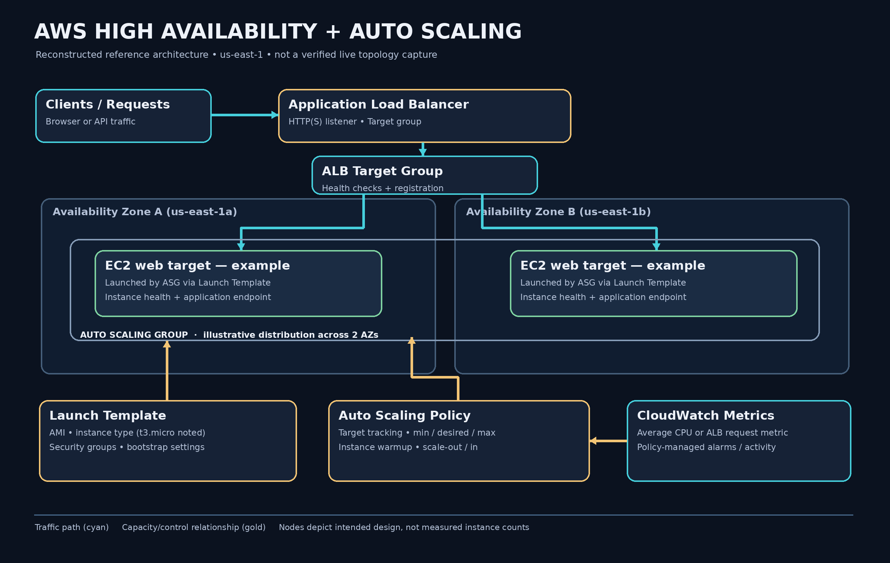

# Highly Available & Auto-Scalable Web Architecture on AWS

### Designing for traffic growth, instance health, and multi-AZ resilience — with Amazon EC2, an Application Load Balancer, and EC2 Auto Scaling.

**AWS EC2 · Launch Templates · Application Load Balancer · Target Groups · Auto Scaling Groups · CloudWatch · VPC · Availability Zones**

> **The engineering question:** Can a web application route requests only to healthy compute targets and adapt its capacity as demand changes—without manually adding or removing EC2 instances?

**Project snapshot.** In an August 2026 hands-on AWS training project, I documented an architecture using an **EC2 Launch Template**, an **Application Load Balancer (ALB)**, an **Auto Scaling Group (ASG)** spanning two Availability Zones, and **CloudWatch-backed target tracking**. The original write-up describes `t3.micro` instances and an ASG configuration supporting growth *up to 10 instances*. The currently retained screenshot is the **LinkedIn project record with an embedded Auto Scaling console thumbnail**.

**Evidence boundary:** This repository reconstructs the documented design and explains how to implement and test it. The supplied image **does not independently prove** a scaling event, a healthy ALB target group, a failover drill, 10 concurrently running instances, or zero downtime. Those outcomes are explicitly labeled **not yet evidenced**, rather than presented as measured results.

[**Deep Dive — start from zero**](DEEP-DIVE.md) · [Architecture](docs/ARCHITECTURE.md) · [Implementation Guide](docs/IMPLEMENTATION.md) · [Validation](docs/VALIDATION.md) · [Troubleshooting](docs/TROUBLESHOOTING.md) · [Evidence Index](docs/EVIDENCE-INDEX.md)

---

## 01 — Why this problem matters

A single EC2 instance is a simple place to host a website, but it also creates operational constraints: capacity is fixed, the instance may fail, and a surge in incoming traffic can overwhelm it. Deploying several instances manually is not the same as building a system that can **manage capacity and availability continuously**.

This project explores three different responsibilities that are often incorrectly treated as one:

1. **Load balancing:** choose an available target for an incoming request.
2. **Health management:** stop routing to unhealthy targets and potentially replace failed instances.
3. **Auto Scaling:** adjust the desired compute capacity as an observed metric changes.

The distinction is essential. **An ALB does not create EC2 instances.** An **ASG does not automatically prove that the application is healthy**. And a **CloudWatch alarm is not evidence that a real scale-out happened**.

## 02 — Architecture in one picture



*Reconstructed conceptual architecture, derived from the original project description; this is not a screenshot of all provisioned resources.*

**Read the architecture like an engineer:**

- A client sends an HTTP(S) request to the internet-facing **ALB**.
- An ALB listener forwards matching requests to a **target group**.
- Targets are healthy EC2 application instances, illustrated in **`us-east-1a`** and **`us-east-1b`**.
- The **Auto Scaling Group** maintains capacity using a **Launch Template** and registers/deregisters its instances with the configured target group.
- A **target tracking scaling policy** evaluates a CloudWatch metric (such as group-average CPU) and requests scale-out or scale-in as appropriate.

**What the diagram does not imply:** that these exact subnet IDs, instance counts, ports, IAM policies, or actual per-AZ target health results were archived from the original build.

## 03 — What was configured vs what has been independently verified

| Area | Original project record / description | Evidence available in this repository | Correct interpretation |
|---|---|---|---|
| EC2 Launch Template | Standardized AMI, instance type and security settings; `t3.micro` noted | Project write-up | **Documented configuration**, not an exported template |
| Application Load Balancer | ALB across `us-east-1a` and `us-east-1b` | Project write-up | Architecture **reported**; listeners / target health not independently archived |
| ASG ↔ ALB | ASG integrated with the ALB target group | LinkedIn record + small embedded Auto Scaling console thumbnail | Reported integration; precise configuration cannot be independently reconstructed |
| Scaling policy | CloudWatch target tracking; upper limit described as 10 instances | Project write-up | **Configuration claim**, not proof of ten-instance scale-out |
| Fault tolerance | Designed to survive some instance or AZ disruptions | No archived fault-injection output | **Design goal**, failover not verified |
| Zero downtime / savings | Original write-up uses strong outcome language | No uptime SLI or cost baseline provided | **Not claimed as proven** here |

**Primary evidence:** [LinkedIn project record, enlarged for readability](evidence/01-linkedin-project-record.png). The thumbnail in that image is too small to confirm all Auto Scaling console details, even after upscaling. [Evidence limitations and next captures →](docs/EVIDENCE-INDEX.md)

## 04 — The design decisions that matter

### Launch Template: make compute repeatable

An ASG creates replacement or additional EC2 instances from a **Launch Template**. The template defines repeatable ingredients such as an AMI, instance type, network/security settings and optionally a bootstrap script. This is infrastructure configuration—not necessarily application deployment automation by itself.

### Two Availability Zones: reduce some single-zone risks

Multi-AZ placement can help maintain availability when one AZ has a problem, **if enough healthy capacity exists in the remaining AZ** and the application/dependencies are designed accordingly. The phrase “two AZs” alone cannot guarantee continuity.

### ALB + target group: traffic distribution is a health decision

The target group defines the protocol, port and health check route the ALB uses to decide whether a target can serve requests. A running EC2 VM may still have a failed application endpoint; a meaningful HTTP health check goes beyond EC2 status checks.

### Target tracking: scale toward a chosen metric target

Target tracking evaluates a utilization or throughput metric and adjusts **desired capacity** within the group’s limits. It is not an instantaneous response to each request. Warm-up time, metric freshness, CloudWatch alarms, launch time, the app start-up time, and target health determine when additional capacity becomes usable.

[See design trade-offs, route paths and configuration constraints →](docs/ARCHITECTURE.md)

## 05 — Build sequence, clearly separated from the original record

This is a **reproduction runbook**, not an original August 2026 terminal transcript:

| Stage | Engineering task | How you should validate it |
|---|---|---|
| 1 | Prepare VPC, two AZ-specific subnets and security rules | VPC and subnet associations documented |
| 2 | Create Launch Template with working web-server bootstrap | Standalone EC2 application returns HTTP 200 |
| 3 | Create ALB, listener, target group and health check | At least one registered healthy target |
| 4 | Create ASG spanning two AZs, attach target group | Instances appear in ASG and target group |
| 5 | Add target tracking policy and capacity boundaries | Describe policy, warmup and min/desired/max values |
| 6 | Generate controlled traffic | CloudWatch metric and scaling activity match actual load |
| 7 | Simulate controlled single-instance failure | Target stops receiving traffic; replacement occurs if health checks configured |
| 8 | Observe traffic, cost and recovery | Record time-stamped outputs, not just console status |

[Step-by-step console + AWS CLI guidance →](docs/IMPLEMENTATION.md)

## 06 — Demonstration evidence


This is the **one unique original project screenshot retained from the supplied material**. It records the earlier project write-up and displays a small AWS Auto Scaling screenshot. The image was upscaled and lightly sharpened to improve reading; no configuration fields were redrawn, replaced, or invented.

**Missing evidence worth adding on a future lab rerun:** ALB DNS response, healthy target group across AZs, ASG details including bounds, target tracking alarm configuration, actual scaling activity timeline, CloudWatch graphs, and a controlled instance-failure recovery result. We leave those missing rather than manufacture them.

## 07 — A real-world failure thought experiment

**Traffic spikes at 15:00:** ALB can distribute requests across healthy targets, but those targets may become CPU-bound. The CloudWatch scaling metric rises; target tracking may request an additional instance. That instance must launch, bootstrap and pass health checks before it improves application capacity.

**An EC2 instance crashes:** Without ALB-aware health and sufficient spare capacity, some requests can fail before the target is removed and replaced. “Auto Scaling enabled” is therefore not equivalent to “users saw zero errors.”

**One Availability Zone becomes impaired:** This design aims to preserve service through the remaining AZ; success depends on ASG placement, capacity, remaining dependencies and actual failure-test results.

[Read the failure-mode playbook →](docs/TROUBLESHOOTING.md)

## 08 — What I learned

- **Control plane versus data plane:** a configured ASG/policy is not proof of working end-user traffic.
- **Healthy EC2 versus healthy application:** status checks, ALB health checks and ASG replacement decisions are distinct.
- **Scale-out versus immediate recovery:** provisioning and warmup introduce real latency.
- **Multi-AZ versus zero downtime:** availability is a property that requires sufficient capacity and validated dependencies, not a marketing adjective.
- **Cost efficiency versus low cost:** scaling down can reduce EC2 runtime expenses, but ALB, data transfer and other services still incur charges.

## 09 — Repository map

```text
aws-high-availability-autoscaling/
├── README.md                  # Recruiter-friendly engineering case study
├── DEEP-DIVE.md               # Beginner-to-advanced learning handbook
├── docs/
│   ├── ARCHITECTURE.md
│   ├── IMPLEMENTATION.md
│   ├── VALIDATION.md
│   ├── TROUBLESHOOTING.md
│   └── EVIDENCE-INDEX.md
├── diagrams/
│   └── architecture.png       # Reconstructed reference diagram
└── evidence/
    └── 01-linkedin-project-record.png
```

**Only one evidence folder; no duplicate `raw/` and `enhanced/` files.**

## 10 — How I would level this up next

1. Export the current (or recreated) Launch Template and ASG configuration with resource IDs redacted.
2. Prove healthy endpoints in both AZs and demonstrate an end-user request through the ALB DNS name.
3. Run a repeatable CPU/HTTP load experiment and publish actual `DesiredCapacity`, `InService` count and scaling activities.
4. Terminate one *test* instance, measure replacement and client-visible errors.
5. Add Terraform/CloudFormation only after reproducing the existing console design, then review IAM permissions, budget guardrails and cleanup.

**Author:** Hafiz Mohammad Sunasara · [GitHub](https://github.com/HafizMohammadSunasara) · [LinkedIn](https://www.linkedin.com/in/hafiz-mohammad-sunasara-118756366)

---

### Official AWS references

- [EC2 Auto Scaling — concepts and operation](https://docs.aws.amazon.com/autoscaling/ec2/userguide/)
- [Target tracking scaling policies](https://docs.aws.amazon.com/autoscaling/ec2/userguide/as-scaling-target-tracking.html)
- [ALB target group health checks](https://docs.aws.amazon.com/elasticloadbalancing/latest/application/target-group-health-checks.html)
- [Attach ALB target groups to Auto Scaling groups](https://docs.aws.amazon.com/autoscaling/ec2/userguide/attach-load-balancer-asg.html)
